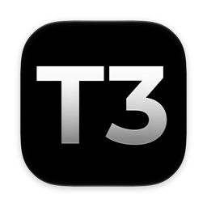
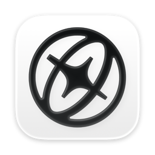
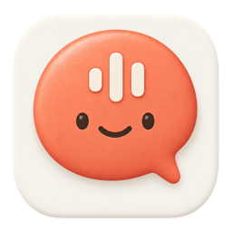
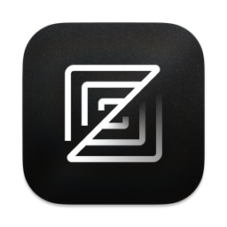
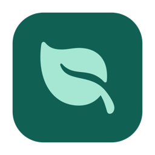

It can feel a bit overwhelming to be a developer right now. Every time you look around, there's a new model, a new coding agent, or another setup that someone insists will change how you work. Even figuring out which apps to use can start to feel like a project of its own.

So I wanted to write down what I'm using at the moment, why I ended up with these apps, and why I'd recommend giving them a try. Most of my setup comes down to fairly ordinary things: working with agents, using my browser, keeping my thoughts and knowledge somewhere I can come back to, and making sure I still have space to think for myself.

<figure class="setup-figure">

<a class="setup-app" href="https://github.com/pingdotgg/t3code">
T3 CodeManage agent sessions
</a><a class="setup-app" href="https://aside.com/">
AsideWork across websites
</a><a class="setup-app" href="https://viciousbuilders.com/pipet">
PipetSpeak your instructions
</a>

<figcaption>Figure 1. The tools I use to work with agents.</figcaption>
</figure>

## 1. T3 Code: working with coding agents

For coding, I primarily use Codex. The subscription gives me enough usage for the way I work, which matters quite a lot when I'm spending a good part of the day with an agent. I also use Claude, though I have less usage available there. I used to use it for Claude Design too, but my product design setup has changed since then.

The question for me became how to make using both fit into my day. I wanted one place to work with Codex and Claude Code, see my usage limits, and access my sessions from my phone when I'm outside. [T3 Code](https://github.com/pingdotgg/t3code) fits that pretty well, with desktop, web, and mobile clients and a [usage view](https://github.com/pingdotgg/t3code/blob/main/docs/user/usage.md).

I actually tried it before and didn't particularly like it. At the time it felt like another agent app in a pile of agent apps, and I didn't see much reason to stick with it. But after coming back to it, I can see how well it fits what I need right now.

Sometimes an app makes more sense once you've figured out what you're looking for.

## 2. Aside: a browser I actually enjoy using

I've been using Arc for a few years, after moving away from Chrome, and I've been pretty in love with it. A clean browser matters to me because it's somewhere I spend so much of my day.

But working with agents has given me another thing to care about: how easily they can work with the websites I'm already using. I wanted to keep the simplicity I liked in Arc while finding something that fit this way of working.

That's how I ended up with [Aside](https://aside.com/), which is built around agents working across your logged-in websites.

I'd heard people recommend it before and wasn't particularly convinced. After trying it myself, though, it's become one of my favourite apps. The clean UI and the way it fits my agent work are what won me over. Those details matter much more when you're actually using an app every day.

## 3. Pipet: getting thoughts into the agent

A friend originally recommended Spokenly, and it helped me get into dictation. When you're explaining something to a coding agent, sometimes it's easier to just say what you're thinking than type the whole thing out. But I ran into some limits with Spokenly, so I've moved to [Pipet](https://viciousbuilders.com/pipet), our own app at viciousbuilders.

[Pipet](https://github.com/viciousbuilders/pipet) is a small, free, open-source macOS dictation app built on Anthony Kroeger's Codex Voice. It sits in the menu bar: hold Right Command, speak, then release to insert the transcript at your cursor. It doesn't submit the message for you, so there's still a chance to read it over before sending.

It uses your own Codex CLI sign-in and sends audio to the Codex transcription backend, so it needs an internet connection. That fits quite naturally into my setup because I'm already using Codex throughout the day.

For me, the appeal is straightforward: less friction between having a thought and getting it down. Especially when that thought takes a little while to explain.

## 4. Doop: working through product design

<figure class="setup-figure">
<a class="setup-notes" href="https://doop.design/">
DoopDesign with agents
</a>
<figcaption>Figure 2. A canvas for working through product design.</figcaption>
</figure>

For product design, I'm now using [Doop](https://doop.design/). I previously used Claude Design, but with the [standalone site being retired](https://support.claude.com/en/articles/17440474-move-from-standalone-claude-design-to-claude) and the experience tied to Claude, I wanted to try something that would fit the other agents I use too.

I tried [Paper](https://paper.design/) next. But its [free tier limits MCP tool calls](https://paper.design/pricing), which became another limit in my workflow, so I moved to Doop.

Doop is an open-source design canvas where you and AI agents can work on the same designs. The canvas uses real HTML and CSS, and it connects to agents such as Codex and Claude Code through MCP. That gives me a place to work through screens and layouts with the agent I'm already using.

I like having a canvas for this part of the work. Sometimes I need to see an idea, move things around, and work out whether the interface makes sense before getting further into the implementation.

<figure class="setup-figure">

<a class="setup-app" href="https://zed.dev/">
ZedThink through the code
</a><a class="setup-app" href="https://viciousbuilders.com/still">
StillKeep distractions out
</a>

<figcaption>Figure 3. Making room for independent work and focus.</figcaption>
</figure>

## 5. Zed: making room for deep work

This is the part of the setup I care about just as much as the agents.

With AI coding becoming more capable, I think it's easy to spend more and more time asking for things and less time working through them yourself. But I still want to learn, understand the code, and be able to sit with a problem without immediately handing it over.

That's why I use Zed. It's fast, minimal, and gives me a comfortable place to do that work. It has AI features too, but it also lets you [turn them all off](https://zed.dev/docs/ai/quick-start).

I've written before about [slowing down to build a stronger foundation](/posts/slow-down-or-move-fast/), and this feels like a practical way to make room for that. There are times when I want an agent helping me build, and times when I want to work something out myself. I want my setup to support both.

## 6. Still: staying focused while the agent works

One slightly strange part of agentic coding is all the waiting. You send a task, the agent starts working, and suddenly you have a few minutes where it's very easy to open social media.

The problem is how quickly that can eat into your work. A quick look becomes a longer one, and getting back into what you were doing takes more effort than you expected.

So I think a blocker earns its place in this setup too. I use my own app, [Still](https://viciousbuilders.com/still), a small macOS website blocker. You can block distracting sites for a focus session or keep the blocklist always on and turn it off when you intentionally want access.

It's a simple idea, but I like having that extra step. Otherwise, the time an agent is supposed to save can disappear into whatever I opened while it was running.

## 7. Apple Notes: keeping knowledge and capturing thoughts

<figure class="setup-figure">
<a class="setup-notes" href="https://support.apple.com/guide/notes/welcome/mac">
Apple NotesOn my phone and desktop
</a>
<ul class="setup-notes-uses"><li>Capture thoughts</li><li>Keep knowledge</li><li>Write to-do lists</li></ul>
<figcaption>Figure 4. One place to return to across mobile and desktop.</figcaption>
</figure>

For knowledge storage, I'm using Apple Notes for now. It's where I keep my to-do lists and capture my thoughts, and I can access it on both my phone and my desktop.

That last part matters quite a lot to me. I want to be able to write a thought down when I'm outside and come back to it when I'm at my desk. Having the same place available in both situations makes it easier to keep using it.

It also fits the kind of simplicity I like in the rest of this setup. I can put down what I need to do, keep knowledge I want to return to, or just write out something I'm thinking about. Right now, that works well for me.

## Where this leaves me

Looking at the whole setup, the thing I keep coming back to is how to make working with AI fit into a day that still includes learning and focused work.

T3 Code, Aside, and Pipet help me work with agents more comfortably. Doop gives me a place to work through product design with them. Zed and Still help me make room for the attention the work still needs from me. Apple Notes gives me a place to keep knowledge and capture thoughts that I can return to across my phone and desktop.

I'm still figuring out what that balance looks like, and I'll probably change parts of this setup over time. But these are the apps that fit how I want to work right now, and hopefully there's something here that fits your day too.
